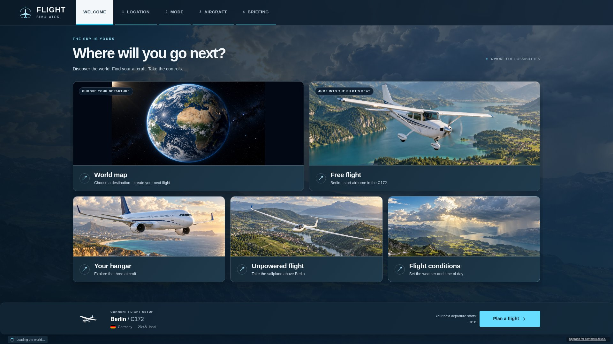
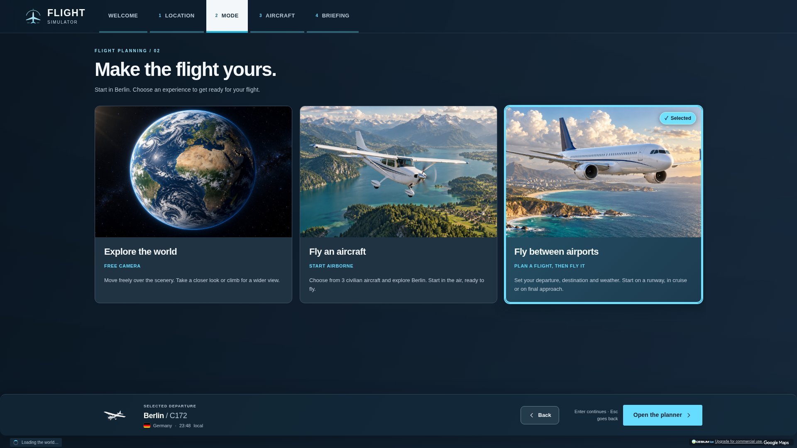
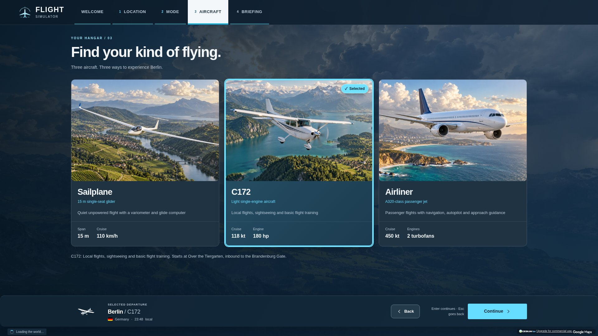
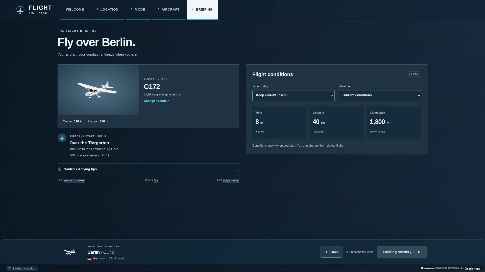
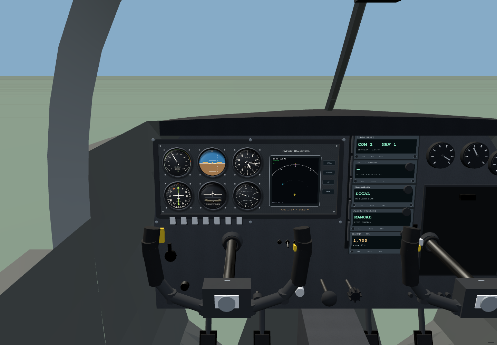

<div align="center">
  
  <h1>Flight Simulator</h1>
  <p><strong>Pick a place. Find your aircraft. Take the controls.</strong></p>
  <p>A civilian flight simulator for the browser, built with Rust, Bevy and WebGPU.</p>
  <p>
    <a href="https://flight-sim-eight.vercel.app/"><strong>Play in your browser ↗</strong></a>
    &nbsp; · &nbsp;
    <a href="#screenshots">Screenshots</a>
    &nbsp; · &nbsp;
    <a href="#run-locally">Run locally</a>
    &nbsp; · &nbsp;
    <a href="docs/development.md">Developer guide</a>
  </p>
</div>

[](https://flight-sim-eight.vercel.app/)

Fly above Google Photorealistic 3D Tiles in a C172, a sailplane or an A320-class airliner.
Explore a city, plan an airport-to-airport flight, or settle into the cockpit and enjoy the view.

**To play:** use a WebGPU-capable browser with internet access. The public site requires no login.

## The experience

- **A world to explore.** Choose a featured destination, search for a place, or travel with the free camera.
- **Three civilian aircraft.** Light-aircraft sightseeing, unpowered gliding and passenger flights.
- **Cockpits with depth.** Live 2D instruments mounted on 3D dashboards, moving controls, spinning propellers and flashing aircraft lights.
- **Plan your flight.** Pick airports, runways, weather and time of day; begin airborne, on a runway or on final approach.
- **Room for the view.** Peripheral chase-view gauges, an on-demand flight menu and an option to hide the overlays.
- **Flight feedback.** Terrain, stall, descent and landing-gear alerts with optional warning sounds.

## Screenshots

| Choose how to fly | Find your aircraft |
| :--- | :--- |
| [](docs/screenshots/flight-modes.jpg) | [](docs/screenshots/aircraft.jpg) |
| **Flight modes** — free camera, local flying or an airport flight. | **Your hangar** — compare aircraft roles and specifications. |

| Prepare for departure | Inside the C172 |
| :--- | :--- |
| [](docs/screenshots/briefing.jpg) | [](docs/screenshots/c172-cockpit-preview.png) |
| **Briefing** — review the setup before launch. | **Cockpit model preview** — the shipped 3D cabin with live instrument textures and sample telemetry. |

The menu screenshots show the running app. Their photographic card images are illustrative artwork,
not gameplay captures. The cockpit image is a development preview without streamed terrain.
[Image provenance and capture instructions →](docs/screenshots/README.md)

## Choose your aircraft

| Aircraft | Best for | Flight deck |
| :--- | :--- | :--- |
| **C172** | Sightseeing and basic flight practice | Analogue gauges, navigation display, radios and animated yokes |
| **Sailplane** | Unpowered exploration from an airborne start | Variometer, airspeed, altitude and a glide navigator |
| **Airliner** | Airport routes and approach practice | Primary flight and navigation displays, engine instruments and autopilot controls |

## Controls at a glance

| Action | Keyboard / mouse |
| :--- | :--- |
| Pitch and roll | Mouse / arrow keys |
| Throttle | **W / S** |
| Rudder | **A / D** |
| Landing gear / brakes | **G / B** |
| Chase / cockpit view | **V** |
| Look around the cockpit | Right-drag |
| Flight planner / aircraft selection | **P / Tab** |
| Flight menu | **Esc** |
| Hide or restore overlays | **F10** |
| All controls | **H** |

A gamepad is also supported. **Options/Start** opens the flight menu; the D-pad navigates it.
Cockpit instruments keep working with overlays hidden. **Esc** always brings the menu back.

## Run locally

Requires **Node.js 22.12 or newer**. The committed browser build runs without installing npm dependencies.

```sh
git clone https://github.com/birkmann/flight-sim.git
cd flight-sim
cp .env.example .env
```

Set `CESIUM_ION_TOKEN` in `.env` to a Cesium ion token with access to Google Photorealistic
3D Tiles, asset `2275207`. The account credential stays on the server.

```sh
npm start
```

Open **[localhost:5197](http://127.0.0.1:5197/)**. Without the terrain token, menus load but
photorealistic scenery does not. Internet access is needed for terrain, place search and live weather.

<details>
<summary><strong>Environment variables</strong></summary>

| Variable | Purpose |
| :--- | :--- |
| `CESIUM_ION_TOKEN` | Server-side terrain credential; `CESIUM_API_KEY` is also accepted |
| `KV_REST_API_URL` + `KV_REST_API_TOKEN` | Optional shared Redis storage for multiplayer; required on serverless hosting |
| `HOST` / `PORT` | Override the local server's listening address and port |

Local multiplayer uses in-memory storage by default. Sessions disappear when the server restarts.

</details>

## Development

The app combines a **Rust / Bevy** simulation, **WebAssembly / WebGPU** rendering,
**React / TypeScript** cockpit instruments and a **Node.js** API for terrain, weather and multiplayer signaling.

```sh
npm ci
npm run dev:api  # Terminal 1: local API
npm run dev      # Terminal 2: source build and dev server; requires Rust + Trunk
```

See the [developer guide](docs/development.md) for Rust/Trunk setup, asset regeneration,
tests, cockpit details and deployment. `npm start` serves the committed build; it does not compile changes.

Production runs on **Vercel**, connected to this repository. Pushes to `main` deploy the
committed browser bundle. Run `npm run build` before publishing Rust or flight-deck changes.

## Current limits

- Multiplayer on the public deployment still needs shared Redis storage configured.
- The sailplane has no tow/winch launch or dedicated thermal lift model.
- Terrain warnings depend on loaded scenery. Flight performance and navigation estimates are approximate.
- Automated UI and geometry checks complement hands-on testing in a hardware WebGPU browser.

## Credits

Based on `birkmann/eu-ui`, with a standalone civilian aircraft catalogue and flight interface.
The sailplane and its instruments build on the local `dwd-hack-26` project.
Google Photorealistic 3D Tiles are accessed through Cesium ion; provider attribution stays visible in-game.

[Aircraft credits](bevy/assets/models/CREDITS.md) · [Artwork credits](bevy/assets/ui/CREDITS.md) ·
[Flag license](bevy/assets/flags/LICENSE) · [Import manifest](docs/import-manifest.json)
